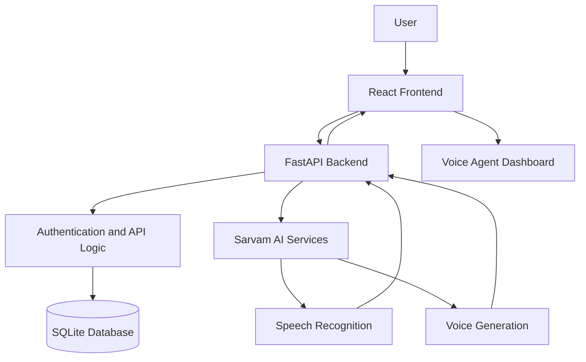

<h1 align="center">Agentra AI – Voice Agent Studio
Build. Speak. Automate.</h1>

An intelligent conversational AI platform powered by **Sarvam AI**, designed to create and manage voice-based AI agents for real-world business workflows.

<p align="center">
  
  
  
  
</p>

<p align="center">
  <a href="https://agentra-ai-rho.vercel.app/"><strong>Live Demo</strong></a> •
  <a href="https://github.com/jasminefloraa/voice-of-Ai"><strong>GitHub Repository</strong></a>
</p>

---

## About the Project

**Agentra AI** is a voice agent platform that enables users to interact with AI-powered conversational agents through speech.

The application integrates Sarvam AI for speech-related capabilities and provides specialized conversational workflows for business use cases.

Instead of relying only on traditional text-based interactions, Agentra AI aims to make conversations more natural through speech recognition, intelligent responses, and voice generation.

## Key Features

- **AI Voice Interaction** – Speech-based interaction with AI agents.
- **Speech-to-Text** – Converts spoken input into text using Sarvam AI.
- **Text-to-Speech** – Generates voice responses from text.
- **Specialized Voice Agents** – Dedicated conversational workflows for different business scenarios.
- **Dashboard** – Centralized interface to access and manage voice agent functionality.
- **Authentication** – User authentication and protected application access.
- **Backend API** – FastAPI-powered backend for application logic and AI integration.

## Voice Agent Use Cases

### 1. Personal Loan Settlement Agent

A conversational agent designed to handle personal loan settlement discussions.

- Explains outstanding loan amounts.
- Communicates settlement offers.
- Handles customer questions.
- Maintains a professional and structured conversation flow.

### 2. Vehicle Insurance Renewal Agent

A conversational agent designed for vehicle insurance renewal discussions.

- Explains insurance renewal options.
- Discusses IDV and premium details.
- Communicates policy benefits.
- Handles customer questions about coverage and renewal.

## Technology Stack

### Frontend

<p>
  
  
  
</p>

### Backend

<p>
  
  
  
</p>

### AI Integration

<p>
  
</p>

### Deployment and Tools

<p>
  
  
  
</p>

## System Architecture



## Project Structure

```text
voice-of-Ai/
│
├── frontend/
│   ├── src/
│   ├── public/
│   ├── package.json
│   └── vite.config.ts
│
├── backend/
│   ├── app/
│   │   └── main.py
│   ├── requirements.txt
│   └── data/
│
├── README.md
└── .gitignore
```

## Getting Started

Follow these instructions to run Agentra AI locally.

### Prerequisites

- Python 3.10+
- Node.js and npm
- Git
- Sarvam AI API key

### 1. Clone the Repository

```bash
git clone https://github.com/jasminefloraa/voice-of-Ai.git
cd voice-of-Ai
```

### 2. Configure the Backend

```bash
cd backend
python -m venv venv
```

Activate the virtual environment.

**Windows:**

```bash
venv\Scripts\activate
```

Install dependencies:

```bash
pip install -r requirements.txt
```

Create a `.env` file in the backend directory:

```env
SARVAM_API_KEY=your_sarvam_api_key
```

Run the backend:

```bash
uvicorn app.main:app --reload --port 8001
```

Backend runs locally at:

`http://localhost:8001`

### 3. Configure the Frontend

Open another terminal:

```bash
cd frontend
npm install
```

Create a `.env` file in the frontend directory:

```env
VITE_API_BASE_URL=http://localhost:8001
```

Start the frontend:

```bash
npm run dev
```

Open the local URL displayed by Vite in your browser.

## Environment Variables

| Variable | Description |
|---|---|
| `SARVAM_API_KEY` | Sarvam AI API authentication key. Keep this on the backend. |
| `VITE_API_BASE_URL` | Backend API base URL used by the frontend. |

**Security:** Never commit API keys, passwords, or private environment files to GitHub.

## Deployment

Agentra AI is deployed using separate frontend and backend hosting services.

| Component | Platform |
|---|---|
| Frontend | Vercel |
| Backend | Render |
| AI Services | Sarvam AI |
| Database | SQLite |

**Live Application:**  
https://agentra-ai-rho.vercel.app/

**Backend:**  
https://agentra-ai-backend.onrender.com

## Future Enhancements

- Public user registration and individual workspaces.
- More customizable voice agents.
- Conversation history and analytics.
- Additional business-specific conversational workflows.
- Improved voice interaction and response handling.

## Developer

**Jasmine Flora J**

B.Tech – Computer Science and Engineering

- GitHub: [@jasminefloraa](https://github.com/jasminefloraa)
- LinkedIn: [jasmine-flora](https://www.linkedin.com/in/jasmine-flora/)

---

<p align="center">
  <strong>Agentra AI – Build. Speak. Automate.</strong>
  <br/>
  Intelligent conversations, powered by AI.
</p>
