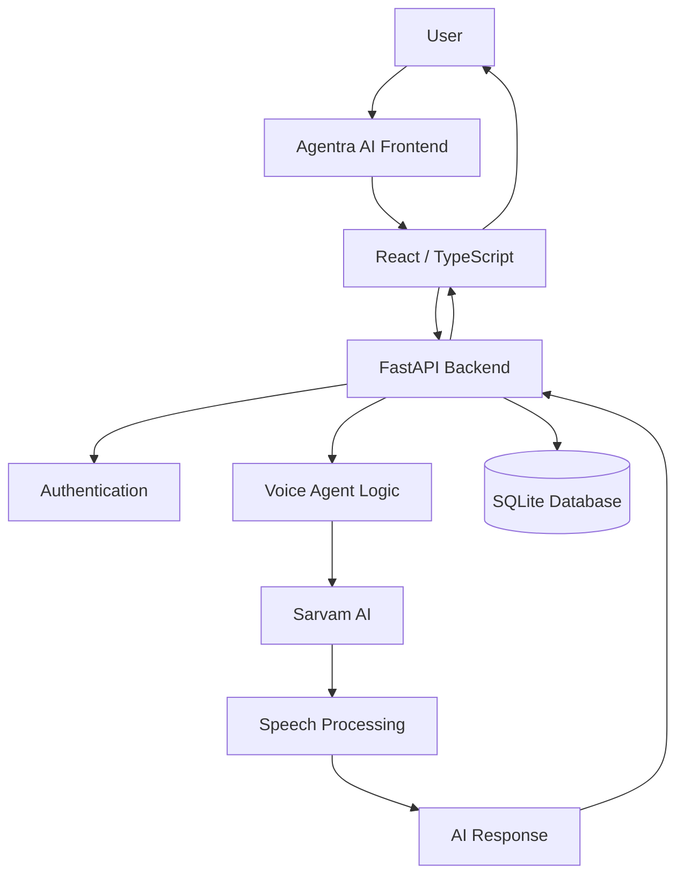

<h1 align="center">Agentra AI – Voice Agent Studio</h1>

<p align="center">
  <strong>Build. Speak. Automate.</strong>
</p>

<p align="center">
  An intelligent conversational AI platform powered by Sarvam AI.
</p>

<p align="center">
  <a href="https://agentra-ai-rho.vercel.app/"><strong>Live Demo</strong></a> ·
  <a href="https://github.com/jasminefloraa/voice-of-Ai"><strong>GitHub Repository</strong></a>
</p>

---

## Overview

**Agentra AI** is an AI-powered Voice Agent Studio designed to build and interact with intelligent conversational voice agents.

Powered by **Sarvam AI**, the platform enables natural voice-based interactions through speech recognition and AI-generated speech responses.

Instead of relying entirely on traditional text-based interfaces, Agentra AI provides a conversational experience where users can interact with specialized AI agents designed for practical business scenarios.

The platform currently demonstrates two specialized voice-agent workflows:

- Personal Loan Settlement Assistant
- Vehicle Insurance Renewal Assistant

## Live Application

<details>
<summary><strong>Deployment information</strong></summary>

| Component | Deployment |
|---|---|
| Frontend | Vercel |
| Backend | Render |
| AI Voice Services | Sarvam AI |
| Database | SQLite |

**Live Website:** https://agentra-ai-rho.vercel.app/

</details>

## Key Features

### AI Voice Interaction
- Speech-to-text processing.
- AI-generated text-to-speech responses.
- Natural conversational interaction.
- Voice-based customer assistance.

### Specialized Voice Agents

**1. Personal Loan Settlement Agent**

An intelligent conversational assistant designed for loan-settlement discussions.

Features:
- Understands loan settlement scenarios.
- Handles outstanding balance discussions.
- Communicates settlement options.
- Provides structured, conversational responses.
- Supports responsible and professional customer interactions.

**2. Vehicle Insurance Renewal Agent**

A conversational assistant designed for vehicle insurance renewal discussions.

Features:
- Handles insurance renewal conversations.
- Discusses vehicle IDV and premium details.
- Explains insurance add-on options.
- Supports premium comparisons.
- Assists with renewal-related queries.

### Application Features
- Web-based dashboard.
- Backend API integration.
- Authentication and session management.
- Dedicated voice-agent workflows.
- Responsive user interface.

## Technology Stack

| Layer | Technologies |
|---|---|
| Frontend | React.js, TypeScript, Vite |
| Backend | Python, FastAPI |
| Database | SQLite |
| AI Voice Services | Sarvam AI |
| Speech Processing | Speech-to-Text (STT), Text-to-Speech (TTS) |
| Deployment | Vercel, Render |
| Version Control | Git, GitHub |

## System Architecture



## Project Structure

```text
voice-of-Ai/
│
├── frontend/
│   ├── src/
│   ├── public/
│   ├── package.json
│   └── vite.config.ts
│
├── backend/
│   ├── app/
│   │   └── main.py
│   ├── requirements.txt
│   └── data/
│
├── README.md
└── .gitignore
```

*The structure above highlights the main application directories. Additional files and modules may exist in the repository.*

## Getting Started

Follow these steps to run Agentra AI locally.

### Prerequisites

Make sure you have installed:

- Python 3.10+
- Node.js and npm
- Git
- A Sarvam AI API key

### 1. Clone the Repository

```bash
git clone https://github.com/jasminefloraa/voice-of-Ai.git
```

```bash
cd voice-of-Ai
```

### 2. Backend Setup

Navigate to the backend directory:

```bash
cd backend
```

Create a virtual environment:

```bash
python -m venv venv
```

Activate it on Windows:

```bash
venv\Scripts\activate
```

Install dependencies:

```bash
pip install -r requirements.txt
```

Configure your backend environment variables using the variable names expected by the application.

Example:

```env
SARVAM_API_KEY=your_sarvam_api_key
```

Start the FastAPI server:

```bash
uvicorn app.main:app --reload --port 8001
```

Backend API:

```text
http://localhost:8001
```

### 3. Frontend Setup

Open another terminal and navigate to the frontend directory:

```bash
cd frontend
```

Install dependencies:

```bash
npm install
```

Create a `.env` file in the frontend directory:

```env
VITE_API_BASE_URL=http://localhost:8001
```

Start the development server:

```bash
npm run dev
```

Open the local application using the URL displayed in your terminal.

## Environment Configuration

| Variable | Purpose |
|---|---|
| `SARVAM_API_KEY` | Authenticates backend requests to Sarvam AI |
| `VITE_API_BASE_URL` | Configures the frontend API endpoint |

**Security Notes:**
- Never commit API keys or passwords to GitHub.
- Keep private credentials in backend environment variables.
- Configure production environment variables separately on Render and Vercel.
- Use persistent storage for the production SQLite database.

## Deployment

Agentra AI uses a separate frontend and backend deployment architecture.

**Frontend – Vercel**
- Framework: Vite
- Root directory: `frontend`
- Build command: `npm run build`
- Output directory: `dist`

**Backend – Render**
- Runtime: Python
- Root directory: `backend`
- Build command: `pip install -r requirements.txt`
- Start command:

```bash
uvicorn app.main:app --host 0.0.0.0 --port $PORT
```

Configure the frontend API URL and backend CORS settings for the production domains.

## Project Highlights

- Full-stack AI application development.
- Integration of Sarvam AI voice capabilities.
- REST API development using FastAPI.
- Frontend and backend integration.
- Authentication and database management.
- Cloud deployment using Vercel and Render.
- Practical conversational AI use cases.

## Future Enhancements

- Public user registration and account management.
- Custom voice-agent creation.
- Conversation history and analytics.
- Multilingual conversational support.
- Advanced agent configuration.
- Improved workspace and user management.
- Additional business-specific voice agents.

## Author

**Jasmine Flora J**

B.Tech – Computer Science and Engineering

GitHub: [@jasminefloraa](https://github.com/jasminefloraa)

LinkedIn: [Jasmine Flora](https://www.linkedin.com/in/jasmine-flora/)

---

<p align="center">
  <strong>Agentra AI</strong>
  <br/>
  Build. Speak. Automate.
  <br/>
  <sub>Powered by Sarvam AI</sub>
</p>
